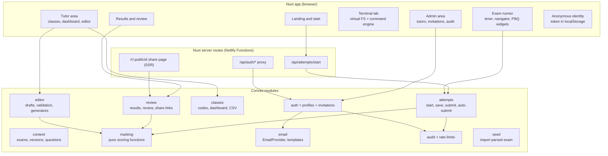
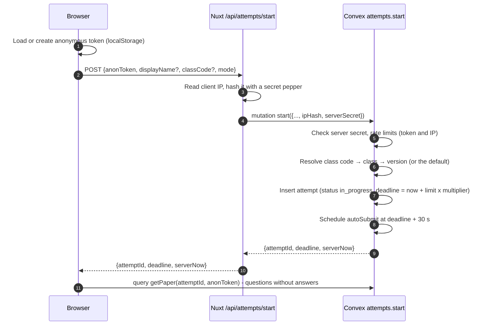
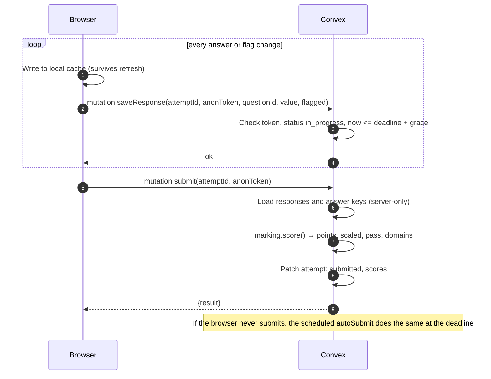
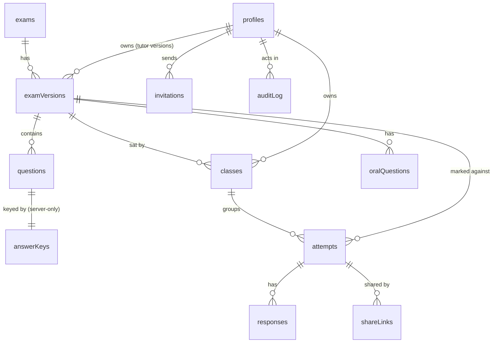
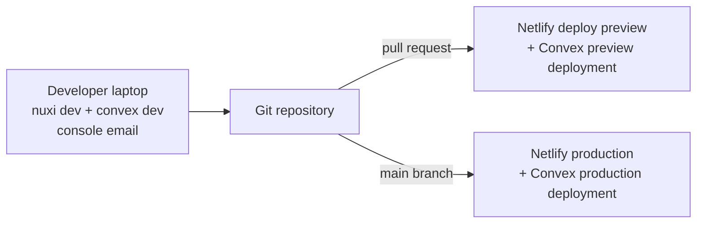

# Salus — High-Level Design (HLD)

| | |
| --- | --- |
| Status | Draft for review |
| Date | 2026-11-08 |
| Owner | Miracle Chimamanda Ndubuisi |
| Requirements | [PRD.md](PRD.md) |
| Detailed design | [LLD.md](LLD.md) |

This document describes how Salus is put together: the main parts, how they talk to each other, where data lives, and how the system stays secure. Requirement IDs in brackets (for example `EX-13`) refer to the PRD.

---

## 1. Design goals

1. **No answer leaks.** Answer keys and explanations stay on the server until an attempt is submitted (SE-1). Every design choice below protects this.
2. **Zero friction for students.** A student starts an exam with no account, only an anonymous token kept in their browser.
3. **The server is the source of truth.** The timer, marking and permissions are all enforced in Convex, never only in the browser.
4. **Content is data.** Questions, PBQs and answer keys are database records grouped into versions, not hard-coded pages. Tutors can edit and version them.
5. **Replaceable parts.** The email provider sits behind an interface. Exam sets come from a parser, so new sets can be added.
6. **Small operational footprint.** Two managed platforms (Netlify and Convex Cloud), with no servers to maintain.

---

## 2. System context

```mermaid
flowchart LR
  subgraph Users
    S[Student<br/>anonymous]
    T[Tutor]
    A[Admin]
  end

  subgraph Netlify
    N[Nuxt 4 app<br/>pages, SSR,<br/>server routes]
  end

  subgraph ConvexCloud[Convex Cloud]
    F[Convex functions<br/>queries, mutations,<br/>actions, scheduler]
    BA[Better Auth component<br/>email OTP, sessions]
    DB[(Convex database<br/>questions, attempts,<br/>answer keys: server-only)]
    RL[Rate limiter component]
  end

  R[Resend<br/>no-reply@salus.fibreware.dev]
  INBOX[Tutor / admin inbox]

  S -->|HTTPS| N
  T -->|HTTPS| N
  A -->|HTTPS| N
  N -->|WebSocket: live queries, mutations| F
  N -->|/api/auth proxy| BA
  F --- DB
  F --- RL
  BA --- DB
  BA -->|EmailProvider| R
  F -->|EmailProvider: invitations| R
  R --> INBOX
```

| Part | Runs on | Responsibility |
| --- | --- | --- |
| Nuxt app | Netlify (static assets on the CDN; SSR and server routes in Netlify Functions) | Every page; the exam runner; tutor and admin areas; the `/api/auth/*` proxy to Better Auth; the attempt-start route that adds the client IP; security headers; share pages |
| Convex functions | Convex Cloud | All business logic: starting attempts, saving answers, marking, classes, editor, invitations, audit |
| Better Auth component | Convex Cloud (HTTP actions) | Email OTP sign-in, sessions, invitation-gated sign-up |
| Convex database | Convex Cloud | All persistent data |
| Rate limiter component | Convex Cloud | Limits on OTP requests, attempt starts and share links |
| Resend | SaaS | Delivers OTP and invitation emails from `salus.fibreware.dev` |
| Browser storage | Student's browser | Anonymous token, display name, in-progress answer cache, UI preferences |

---

## 3. Key design decisions

| # | Decision | Why | Alternatives considered |
| --- | --- | --- | --- |
| D1 | **Convex** for database, backend logic and scheduling | Live queries give the tutor dashboard instant updates (CL-5); transactions make marking consistent; built-in scheduler auto-submits at the deadline | Supabase + Postgres; a Node API with Postgres |
| D2 | **Nuxt 4 on Netlify** for the frontend | Chosen stack; SSR for public pages (landing, share pages), client rendering for the exam runner | Nuxt static only (would lose share-page previews and the server-side proxy) |
| D3 | **Marking only on the server** | Answer keys never leave Convex before submission (SE-1) | Marking in the browser, which would leak keys |
| D4 | **Anonymous bearer token** for students | No sign-up (PRD non-goal). The browser keeps a random 256-bit token; the server stores only its SHA-256 hash | Device fingerprinting (unreliable, privacy-hostile) |
| D5 | **Better Auth email OTP** through `@convex-dev/better-auth` | Passwordless sign-in with 6-digit codes; Vue/Nuxt supported; data stays in Convex | Convex Auth (React-first); a hand-built OTP system (kept as the fallback, see Risks) |
| D6 | **Same-origin auth proxy** (`/api/auth/*` in Nuxt forwards to the Convex site URL) | Session cookies are set on the app's own domain, which works with SSR, and the proxy can pass the real client IP for rate limits | Calling the Convex site URL directly (cross-site cookies, no reliable client IP) |
| D7 | **EmailProvider interface**, Resend first | Provider can be changed with one adapter (AR-4) | Calling Resend directly from every function |
| D8 | **Copy-on-write exam versions** | Attempts always mark against the exact version sat (ED-4); tutors edit drafts safely | Editing questions in place (would change old results) |
| D9 | **Answers in their own table** (`responses`), one row per question per attempt | Small writes, no write conflicts between rapid saves, attempt document stays small | Storing all answers inside the attempt document |
| D10 | **Simulated terminal runs fully in the browser** | Lab is practice only and holds no secrets; no server cost; works offline after load | A real container per student (cost, security risk) |
| D11 | **Content parsed from Markdown** by a build-time script | Your existing documents become the seed data; new exam sets reuse the same format (AR-1) | Typing the questions into an admin UI |

---

## 4. Logical components



| Component | Main duties | PRD |
| --- | --- | --- |
| **content** | Exams, versions and questions; returns question data with answer keys removed | AR-1, ED-7 |
| **attempts** | Start an attempt (class code, version, mode, deadline); save answers and flags; submit; auto-submit at the deadline | EX-1 to EX-12, SE-3, SE-4 |
| **marking** | Pure functions: normalise answers, mark MCQs and PBQ parts, total points, scaled score, domain breakdown | EX-13 to EX-15, PB-1 to PB-3, ED-10 |
| **review** | Results, per-question review with explanations, attempt history, share links | EX-16 to EX-20, CL-9 |
| **classes** | Class codes, open/close, tutor dashboard, class statistics, CSV export, deleting attempts | CL-1 to CL-11 |
| **editor** | Copy a version into a draft, edit MCQs and PBQs, run generators, validate, preview, publish | ED-1 to ED-10 |
| **auth, profiles, invitations** | OTP sign-in, invitation-only sign-up, roles, removing and restoring tutors | AU-1 to AU-7 |
| **email** | `EmailProvider` interface, Resend and console adapters, templates | AR-4 |
| **audit, rate limits** | Audit log writes, rate-limit checks, IP hashing, 30-day clean-up | AU-7, SE-5, PR-3 |
| **seed** | Imports the parsed exam JSON as the default published version | AR-1, ED-7 |
| **terminal lab** (browser only) | Virtual file system built from `build-lab.sh`, command parser, pipes, lab checks | LB-1 to LB-9 |

---

## 5. Key flows

### 5.1 Start an exam



### 5.2 Answer, save and submit



### 5.3 Tutor invitation and OTP sign-in

```mermaid
sequenceDiagram
  autonumber
  participant Ad as Admin browser
  participant C as Convex
  participant E as EmailProvider (Resend)
  participant Tu as Tutor browser
  participant BA as Better Auth (via /api/auth proxy)
  Ad->>C: invitations.create(email)
  C->>C: Require admin; store sha256(token), expires in 7 days; audit
  C->>E: send(invitation email with /invite/<token>)
  Tu->>C: invitations.accept(token)
  C->>C: Check hash, not expired, pending; create auth user + tutor profile; mark accepted
  Tu->>BA: emailOtp.sendVerificationOtp(email, type sign-in)
  BA->>E: send(6-digit code)
  Tu->>BA: signIn.emailOtp(email, code)
  BA-->>Tu: Session cookie (7 days)
```

Later sign-ins skip the invitation steps (PRD AU sign-in flow). Better Auth runs with sign-up turned off, so only the invitation step can create a user.

### 5.4 Tutor dashboard live update

A tutor's dashboard subscribes to a Convex query over `attempts` filtered by class. When a student submits, Convex pushes the new row to every open dashboard within a second or two (CL-5 target: 5 seconds). No polling is needed.

### 5.5 Share link

A student creates a share link → Convex stores a random 128-bit `publicId`. The page `/r/<publicId>` is rendered by Nuxt on the server, which calls a Convex query that returns the result and review only if the link has not been revoked.

---

## 6. Data overview



- **Published versions are immutable.** Editing makes a new draft; publishing freezes it (D8).
- **Answer keys** live in a separate table that only internal functions read (SE-1).
- **Students** exist only as a hash of their anonymous token on `attempts.anonKey`.
- The full schema, field types and indexes are in the [LLD](LLD.md#3-data-model).

---

## 7. Security architecture

### 7.1 Trust boundaries

| Boundary | What crosses it | Controls |
| --- | --- | --- |
| Browser → Nuxt | Page requests, attempt start, auth calls | HTTPS only, CSP, `X-Frame-Options: DENY`, same-origin cookies (`Secure`, `HttpOnly`, `SameSite=Lax`) |
| Browser → Convex (WebSocket) | Student queries and mutations; tutor and admin functions | Every student function requires the anonymous token; every tutor or admin function checks the Better Auth session and role on the server (SE-2) |
| Nuxt → Convex | Attempt start with IP hash | Shared server secret checked by the mutation; IP is hashed with a secret pepper before it leaves Nuxt |
| Convex → Resend | Email content | API key in Convex environment settings (SE-8) |

### 7.2 Threats and mitigations

| Threat | Mitigation |
| --- | --- |
| Student reads answer keys from network traffic | Student queries strip keys; an automated test calls every public query and fails if any key field appears (PRD success metric) |
| Student edits answers after time runs out | Server checks `now <= deadline + 30 s`; scheduled auto-submit closes the attempt |
| Student reads or changes another student's attempt | Token hash must match `attempts.anonKey`; IDs alone are not enough |
| Tutor reads another tutor's class | Every class and attempt query checks that `class.tutorId` is the caller (or the caller is the admin) |
| OTP brute force | 6 digits, 10-minute expiry, 5 attempts per code, request limits per email and per IP (AU-1 to AU-3) |
| Email enumeration on sign-in | Same response whether or not the email is registered |
| Stolen invitation link | Single use, 7-day expiry, bound to one email, only its hash is stored |
| XSS through tutor-written content | All user text rendered as plain text (Vue escaping, no `v-html`); strict CSP |
| Flooding anonymous endpoints | Rate limiter component (token and IP limits), closable class codes |
| Secrets in the repository | Secrets only in Netlify and Convex environment settings; `.env*` ignored by git |

---

## 8. Deployment and environments



| Environment | Frontend | Backend | Email | Notes |
| --- | --- | --- | --- | --- |
| Local | `nuxi dev` on localhost | `npx convex dev` (personal dev deployment) | Console adapter (emails printed in the Convex logs) | Seeded from the Markdown files |
| Preview | Netlify deploy preview per pull request | Convex preview deployment (created by `convex deploy` with a preview deploy key) | Console adapter | Lets you test a change before release |
| Production | Netlify, Netlify subdomain for now (later `salus.fibreware.dev` if wanted) | Convex Cloud production deployment | Resend from `no-reply@salus.fibreware.dev` | Admin email set in `ADMIN_EMAIL` |

The Netlify build runs `npx convex deploy --cmd "npx nuxi build"`, so the Convex backend and the Nuxt frontend are always released together and the frontend is built with the matching Convex URL.

---

## 9. Non-functional design

| Concern | Approach |
| --- | --- |
| Performance (QA-3) | Exam paper loaded once per attempt and cached; one small mutation per answer; static assets on the Netlify CDN |
| Scale | Convex handles concurrent classes; the expected load is a few hundred students at once. The largest document is a PBQ with a log, about 15 KB, far below Convex's 1 MB limit |
| Reliability | Answers cached in the browser and re-sent after reconnect; the server deadline and auto-submit mean a lost tab never leaves an attempt open |
| Accessibility (QA-2) | Nuxt UI components with keyboard support; navigator grid and PBQ widgets built to WCAG 2.2 AA |
| Observability | Convex dashboard logs and function metrics; Netlify function logs; audit log for security events; optional Sentry later |
| Backups | Scheduled Convex snapshot exports (weekly), kept outside Convex |
| Privacy (PR-1 to PR-5) | No student personal data; IP stored only as a peppered hash and deleted after 30 days by a cron job |

---

## 10. Risks and follow-ups

| Risk | Plan |
| --- | --- |
| The Nuxt integration for `@convex-dev/better-auth` is early-stage, and a bundling bug has been reported for email OTP on Convex | Stage 1 starts with a one-day spike: install the pinned versions, deploy, and send and verify a code end to end. If it fails, use the fallback in the [LLD](LLD.md#9-authentication): a small OTP module in Convex (hashed codes, the same limits) with sessions held in an `HttpOnly` cookie set by the Nuxt proxy |
| Resend domain not verified in time | Development and preview use the console adapter, so only production waits on DNS for `salus.fibreware.dev` |
| Markdown format drift in future exam files | The parser validates counts, domains and answer coverage, and fails loudly with line numbers |
| Netlify Functions cold starts on share pages | Acceptable for v1; cache share pages at the CDN for 60 seconds |

**Sources checked for library support (Nov 2026):**
- [Convex Better Auth component](https://www.convex.dev/components/better-auth)
- [Better Auth Convex integration guide](https://better-auth.com/docs/integrations/convex)
- [nuxt-convex Better Auth integration](https://nuxt-convex.onmax.me/integrations/better-auth)
- [better-auth.nuxt.dev Convex integration](https://better-auth.nuxt.dev/integrations/convex)
- [Convex community thread on the email OTP bundling issue](https://discord-questions.convex.dev/m/1466515176630124616)
