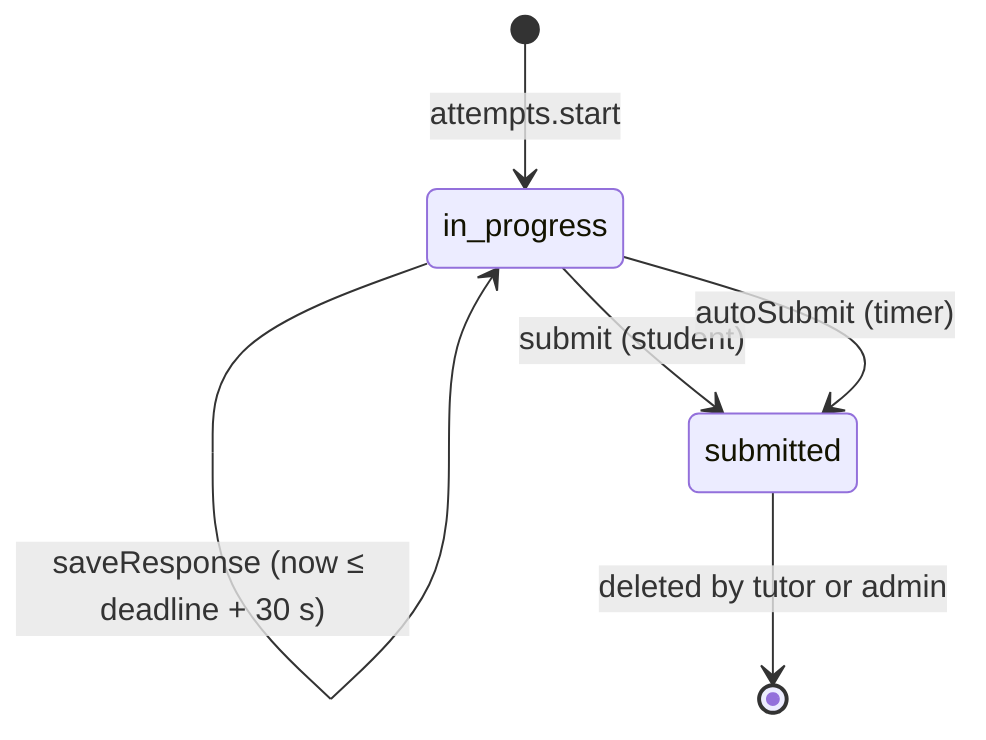

# Salus — Low-Level Design (LLD)

| | |
| --- | --- |
| Status | Draft for review |
| Date | 2026-11-08 |
| Owner | Miracle Chimamanda Ndubuisi |
| Requirements | [PRD.md](PRD.md) |
| Architecture | [HLD.md](HLD.md) |

This document is the build guide: folder layout, schema, function signatures, algorithms and test plan. Code blocks are TypeScript sketches. They show shapes and rules, not final code. Requirement IDs (for example `EX-13`) refer to the PRD; decision IDs (for example `D8`) refer to the HLD.

---

## 1. Repository layout

A single Nuxt 4 app with the Convex backend in `convex/`.

```text
salus/
├─ app/                          # Nuxt 4 source (srcDir)
│  ├─ pages/                     # routes, see §14
│  ├─ components/
│  │  ├─ exam/                   # Timer, Navigator, QuestionMcq, FlagButton, PacingBanner
│  │  ├─ pbq/                    # PbqSshLog, PbqNmap, PbqHashCheck, PbqPermissions, PbqFirewall
│  │  ├─ review/                 # ResultSummary, DomainChart, ReviewItem
│  │  ├─ tutor/                  # ClassTable, AttemptTable, VersionEditor, McqForm, PbqTemplateForms
│  │  ├─ admin/                  # TutorList, InvitationList, AuditTable
│  │  └─ lab/                    # Terminal, CheatSheet
│  ├─ composables/               # useAnonIdentity, useAttempt, usePacing, useAuth, useConvex
│  ├─ lib/
│  │  ├─ terminal/               # virtual FS + command engine (browser only), see §13
│  │  └─ pacing.ts
│  ├─ middleware/                # tutor.ts, admin.ts route guards
│  └─ app.config.ts
├─ server/                       # Nuxt server (Netlify Functions)
│  ├─ api/auth/[...].ts          # proxy to Better Auth on the Convex site URL
│  ├─ api/attempts/start.post.ts # adds the hashed client IP, then calls Convex
│  └─ utils/ip.ts
├─ convex/
│  ├─ schema.ts
│  ├─ convex.config.ts           # registers components: betterAuth, rateLimiter
│  ├─ auth.ts                    # Better Auth setup (email OTP)
│  ├─ http.ts                    # registers Better Auth HTTP routes
│  ├─ crons.ts
│  ├─ lib/                       # guards.ts, anon.ts, codes.ts, rng.ts, audit.ts, rateLimits.ts
│  ├─ marking/                   # normalise.ts, score.ts (pure, unit-tested)
│  ├─ generators/                # one file per PBQ template (pure, seeded)
│  ├─ email/                     # provider.ts, resend.ts, console.ts, templates.ts
│  ├─ attempts.ts  content.ts  review.ts  classes.ts  editor.ts
│  ├─ invitations.ts  profiles.ts  admin.ts  shareLinks.ts  seed.ts
│  └─ _generated/
├─ shared/                       # types shared by app/ and convex/ (question payloads, answers)
├─ content/
│  ├─ source/secplus-701-mock-exam.md
│  ├─ source/build-lab.sh
│  └─ seed/sy0-701.json          # parser output, committed
├─ scripts/parse-exam.ts         # Markdown → seed JSON, see §6
├─ tests/                        # unit (vitest), convex (convex-test), e2e (playwright)
├─ docs/  PRD.md  HLD.md  LLD.md
├─ netlify.toml
└─ nuxt.config.ts
```

---

## 2. Technology and versions

Exact versions are pinned during the Stage 1 spike (HLD §10). These are the starting choices.

| Area | Package | Notes |
| --- | --- | --- |
| Framework | `nuxt@4`, `vue@3.5`, TypeScript `strict` | Netlify preset is detected automatically |
| UI | `@nuxt/ui` (Tailwind CSS v4) | Dark mode, accessible components |
| Backend | `convex` | Queries, mutations, actions, scheduler, crons |
| Convex in Vue | `convex/browser` (`ConvexClient`) wrapped in our own `useConvex*` composables | Live query subscriptions. Spike (T-003): `convex-vue` not used, no release since July 2025 and still 0.x |
| Auth | `better-auth@1.7.18` + `@convex-dev/better-auth@0.13.0` + `emailOTP` plugin | Pair confirmed to deploy in the T-003 spike (2026-11-08). The component requires `better-auth >=1.7.16 <1.8.0`; upgrade the two together |
| Rate limits | `@convex-dev/rate-limiter` | Token-bucket and fixed-window limits |
| Email | `resend` | Behind `EmailProvider` |
| Validation | `convex/values` validators; `zod` in the parser | |
| Tests | `vitest`, `convex-test`, `@playwright/test` | |

---

## 3. Data model

### 3.1 Convex schema

```ts
// convex/schema.ts
import { defineSchema, defineTable } from "convex/server";
import { v } from "convex/values";

const domain = v.union(v.literal("1.0"), v.literal("2.0"), v.literal("3.0"), v.literal("4.0"), v.literal("5.0"));

export default defineSchema({
  profiles: defineTable({
    authUserId: v.string(),                 // Better Auth user id (component table)
    email: v.string(),                      // lower-cased
    name: v.optional(v.string()),
    role: v.union(v.literal("admin"), v.literal("tutor")),
    status: v.union(v.literal("active"), v.literal("removed")),
    createdAt: v.number(),
  })
    .index("by_authUserId", ["authUserId"])
    .index("by_email", ["email"]),

  invitations: defineTable({
    email: v.string(),
    tokenHash: v.string(),                  // sha256(token), hex
    invitedBy: v.id("profiles"),
    expiresAt: v.number(),
    status: v.union(v.literal("pending"), v.literal("accepted"), v.literal("cancelled"), v.literal("expired")),
    createdAt: v.number(),
    acceptedAt: v.optional(v.number()),
  })
    .index("by_tokenHash", ["tokenHash"])
    .index("by_email_status", ["email", "status"]),

  exams: defineTable({
    slug: v.string(),                       // "sy0-701"
    title: v.string(),
    timeLimitMin: v.number(),               // 90
    passScaled: v.number(),                 // 750
    comfortScaled: v.number(),              // 800
    domainTarget: v.number(),               // 0.81
    defaultVersionId: v.optional(v.id("examVersions")),
  }).index("by_slug", ["slug"]),

  examVersions: defineTable({
    examId: v.id("exams"),
    ownerId: v.optional(v.id("profiles")),  // undefined = default exam (admin-managed)
    parentVersionId: v.optional(v.id("examVersions")),
    label: v.string(),
    versionNo: v.number(),
    status: v.union(v.literal("draft"), v.literal("published"), v.literal("archived")),
    totalPoints: v.number(),                // computed on publish (ED-10)
    publishedAt: v.optional(v.number()),
    updatedAt: v.number(),
  })
    .index("by_exam_owner", ["examId", "ownerId"])
    .index("by_owner_status", ["ownerId", "status"]),

  questions: defineTable({
    versionId: v.id("examVersions"),
    order: v.number(),                      // sort key within a section
    section: v.union(v.literal("pbqA"), v.literal("pbqB"), v.literal("mcq")),
    displayNumber: v.string(),              // "1", "B3", "47"
    kind: v.union(v.literal("mcq"), v.literal("pbq")),
    domain,
    points: v.number(),                     // mcq = 1; pbq = number of scored parts
    stem: v.string(),                       // plain text / limited Markdown, rendered escaped
    // mcq only
    options: v.optional(v.array(v.object({ id: v.string(), text: v.string() }))), // id "A".."F"
    chooseCount: v.optional(v.number()),    // 1 or 2
    // pbq only
    template: v.optional(v.union(
      v.literal("sshLog"), v.literal("nmap"), v.literal("hashCheck"),
      v.literal("permissions"), v.literal("firewall"))),
    payload: v.optional(v.any()),           // typed by PbqPayload in shared/, validated on write
  }).index("by_version_section_order", ["versionId", "section", "order"]),

  answerKeys: defineTable({                 // SERVER-ONLY (SE-1)
    questionId: v.id("questions"),
    versionId: v.id("examVersions"),
    correct: v.optional(v.array(v.string())),  // mcq option ids, e.g. ["A","B"]
    parts: v.optional(v.any()),                // PbqKey in shared/
    explanation: v.string(),
  })
    .index("by_question", ["questionId"])
    .index("by_version", ["versionId"]),

  oralQuestions: defineTable({
    versionId: v.id("examVersions"),
    order: v.number(),
    question: v.string(),
    modelAnswer: v.string(),
  }).index("by_version", ["versionId", "order"]),

  classes: defineTable({
    tutorId: v.id("profiles"),
    name: v.string(),
    code: v.string(),                       // "SEC-4K7Q", stored upper-case
    versionId: v.id("examVersions"),        // must be published
    timeMultiplier: v.number(),             // 1, 1.25, 1.5, 2 (EX-21)
    status: v.union(v.literal("open"), v.literal("closed")),
    createdAt: v.number(),
  })
    .index("by_code", ["code"])
    .index("by_tutor", ["tutorId"]),

  attempts: defineTable({
    anonKey: v.string(),                    // sha256(anonToken), hex (D4)
    displayName: v.optional(v.string()),
    classId: v.optional(v.id("classes")),
    versionId: v.id("examVersions"),
    mode: v.union(v.literal("standard"), v.literal("retake")),
    status: v.union(v.literal("in_progress"), v.literal("submitted"), v.literal("expired")),
    startedAt: v.number(),
    deadline: v.number(),                   // startedAt + limit × multiplier
    submittedAt: v.optional(v.number()),
    submittedBy: v.optional(v.union(v.literal("student"), v.literal("timer"))),
    shuffleSeed: v.number(),                // uint32
    autoSubmitJobId: v.optional(v.id("_scheduled_functions")),
    result: v.optional(v.object({
      points: v.number(),
      totalPoints: v.number(),
      scaled: v.number(),
      passed: v.boolean(),
      comfortable: v.boolean(),
      domains: v.array(v.object({ domain, points: v.number(), max: v.number() })),
      flaggedCount: v.number(),
      timeUsedSec: v.number(),
    })),
    ipHash: v.optional(v.string()),         // cleared after 30 days (PR-3)
  })
    .index("by_anonKey", ["anonKey", "startedAt"])
    .index("by_class", ["classId", "startedAt"])
    .index("by_status_deadline", ["status", "deadline"]),

  responses: defineTable({                  // one row per answered or flagged question (D9)
    attemptId: v.id("attempts"),
    questionId: v.id("questions"),
    value: v.optional(v.any()),             // AnswerValue in shared/
    flagged: v.boolean(),
    updatedAt: v.number(),
    // filled at marking time
    earned: v.optional(v.number()),
    partResults: v.optional(v.array(v.boolean())),
  })
    .index("by_attempt_question", ["attemptId", "questionId"]),

  shareLinks: defineTable({
    attemptId: v.id("attempts"),
    publicId: v.string(),                   // 22-char base64url, 128-bit random
    anonKey: v.string(),
    createdAt: v.number(),
    revokedAt: v.optional(v.number()),
  })
    .index("by_publicId", ["publicId"])
    .index("by_attempt", ["attemptId"]),

  auditLog: defineTable({
    actorId: v.optional(v.id("profiles")),  // undefined = system / anonymous
    action: v.string(),                     // see §12
    target: v.optional(v.string()),
    meta: v.optional(v.any()),
    ipHash: v.optional(v.string()),
    at: v.number(),
  }).index("by_at", ["at"]),
});
```

Better Auth keeps its own `user`, `session`, `account` and `verification` tables inside the component. Rate-limit state lives inside the rate-limiter component, so the PRD's `rateLimits` table is not needed.

### 3.2 Shared content types

```ts
// shared/content.ts
export type PbqPayload =
  | { template: "sshLog"; intro: string; log: string; parts: TextPart[] }          // 1a–1c scored, 1d practice
  | { template: "nmap"; intro: string; scan: string; parts: PortPart[] }
  | { template: "hashCheck"; intro: string; vendorHashes: string; computed: string; parts: (PickPart | McqPart)[] }
  | { template: "permissions"; intro: string; listings: string; sshdConfig: string; parts: TextPart[] }
  | { template: "firewall"; intro: string; requirements: string[]; diagram: string;
      rules: { source: string; destination: string; protocol: "TCP" | "UDP" }[];
      portChoices: string[]; actionChoices: ("ALLOW" | "DENY")[] };

export type TextPart = { id: string; prompt: string; kind: "ip" | "text" | "integer" | "octal" | "directive" | "path"; scored: boolean };
export type PortPart = { id: string; prompt: string; kind: "port" | "portPair" };   // B2a/B2b ask for two ports
export type PickPart = { id: string; prompt: string; kind: "pick"; choices: string[] };
export type McqPart  = { id: string; prompt: string; kind: "mcq"; options: { id: string; text: string }[] };

export type PbqKey =
  | { parts: Record<string, string | string[]>; practice?: Record<string, string> } // text/port/pick/mcq parts
  | { rules: { port: string; action: "ALLOW" | "DENY" }[] };                         // firewall

export type AnswerValue =
  | { kind: "mcq"; optionIds: string[] }
  | { kind: "pbq"; parts: Record<string, string | string[]> }
  | { kind: "firewall"; rules: { port: string | null; action: string | null }[] };
```

Payloads are checked against these types on every editor save and during seeding.

---

## 4. Anonymous identity (students)

| Item | Rule |
| --- | --- |
| Token | 32 random bytes from `crypto.getRandomValues`, base64url (43 characters). Created on first visit. |
| Storage | `localStorage["salus.anon.v1"] = { token, displayName?, createdAt }`, wrapped in try/catch. If storage is blocked, a session-only token is used and a notice is shown. |
| Server side | Only `anonKey = sha256(token)` (hex) is stored. Every student function takes `anonToken`, hashes it and compares it with `attempt.anonKey`. |
| History | The server is the source of truth: `review.myAttempts({ anonToken })` lists attempts by `anonKey`. |
| Export (EX-20) | Downloads `salus-progress.json = { v: 1, token, displayName, exportedAt }`. The page warns that the file is a secret. |
| Import | Reads the file, validates it, replaces the local token after confirmation. The attempt history then appears from the server. |

```ts
// convex/lib/anon.ts
export async function anonKeyOf(token: string): Promise<string> {
  if (!/^[A-Za-z0-9_-]{43}$/.test(token)) throw new ConvexError("BAD_TOKEN");
  const bytes = new TextEncoder().encode(token);
  const digest = await crypto.subtle.digest("SHA-256", bytes);
  return [...new Uint8Array(digest)].map(b => b.toString(16).padStart(2, "0")).join("");
}

export async function loadOwnAttempt(ctx, attemptId, anonToken) {
  const attempt = await ctx.db.get(attemptId);
  if (!attempt || attempt.anonKey !== (await anonKeyOf(anonToken))) throw new ConvexError("NOT_FOUND"); // same error for both cases
  return attempt;
}
```

---

## 5. Convex function catalogue

**Access** column: **anon** = needs a valid `anonToken` that owns the record; **server** = called by the Nuxt server with `SERVER_SECRET`; **tutor** / **admin** = Better Auth session plus role (admin passes every tutor check); **internal** = not callable from clients.

### 5.1 Students

| Function | Type | Access | Args → returns | Notes |
| --- | --- | --- | --- | --- |
| `attempts.start` | mutation | server | `{ serverSecret, anonToken, displayName?, classCode?, mode, ipHash }` → `{ attemptId, deadline, serverNow }` | §7.1 |
| `attempts.getPaper` | query | anon | `{ attemptId, anonToken }` → `Paper` | Questions without keys, options shuffled (§7.3) |
| `attempts.getState` | query | anon | `{ attemptId, anonToken }` → `{ status, deadline, serverNow, responses[] }` | Used on load and refresh |
| `attempts.saveResponse` | mutation | anon | `{ attemptId, anonToken, questionId, value?, flagged }` → `{ ok, savedAt }` | §7.2 |
| `attempts.submit` | mutation | anon | `{ attemptId, anonToken }` → `Result` | §7.4 |
| `attempts.autoSubmit` | internal mutation | internal | `{ attemptId }` | Scheduled at `deadline + 30 s` |
| `review.getResult` | query | anon | `{ attemptId, anonToken }` → `Result` | Only when submitted |
| `review.getReview` | query | anon | `{ attemptId, anonToken }` → `ReviewItem[]` | Includes keys and explanations; only when submitted |
| `review.myAttempts` | query | anon | `{ anonToken }` → `AttemptSummary[]` | EX-19 |
| `shareLinks.create` | mutation | anon | `{ attemptId, anonToken }` → `{ publicId }` | Rate-limited, one active link per attempt |
| `shareLinks.revoke` | mutation | anon | `{ publicId, anonToken }` | |
| `shareLinks.view` | query | public | `{ publicId }` → `Result & ReviewItem[]` or `null` | `null` when revoked or deleted |
| `content.oralQuestions` | query | public | `{ versionId }` → `{ question, modelAnswer }[]` | Not secret; CL-10 |
| `classes.lookupCode` | query | public | `{ code }` → `{ name, open }` or `null` | For the start screen; reveals nothing else |

### 5.2 Tutors

| Function | Type | Args → returns | Notes |
| --- | --- | --- | --- |
| `classes.create` | mutation | `{ name, versionId, timeMultiplier? }` → `{ classId, code }` | Version must be published and owned by the tutor or be the default |
| `classes.update` | mutation | `{ classId, name?, versionId?, status?, timeMultiplier? }` | Owner check |
| `classes.mine` | query | `{}` → `ClassSummary[]` | |
| `classes.attempts` | query | `{ classId, filter? }` → `AttemptRow[]` | Live dashboard (CL-5) |
| `classes.stats` | query | `{ classId }` → `{ avgScaled, passRate, domains[], mostMissed[10] }` | CL-6 |
| `classes.attemptReview` | query | `{ attemptId }` → `ReviewItem[]` | CL-7: the attempt's class must belong to the caller |
| `classes.exportCsv` | action | `{ classId }` → `string` (CSV) | CL-8 |
| `classes.deleteAttempts` | mutation | `{ attemptIds: Id[] }` (max 100) | CL-11: deletes responses and share links, writes audit |
| `editor.myVersions` | query | `{}` → `VersionSummary[]` | |
| `editor.createDraft` | mutation | `{ fromVersionId, label }` → `{ versionId }` | Copies questions, keys and oral questions (§10.1) |
| `editor.getDraft` | query | `{ versionId }` → `{ version, questions (with keys), oral }` | Owner only; keys allowed here because tutors author them |
| `editor.saveQuestion` | mutation | `{ versionId, question, key }` → `{ questionId }` | Draft only; validates payload |
| `editor.deleteQuestion` / `editor.reorder` | mutation | | Draft only |
| `editor.generate` | mutation | `{ versionId, questionId, seed? }` → `{ question, key }` | Runs the template generator (§10.3) |
| `editor.validate` | query | `{ versionId }` → `Issue[]` | ED-2, ED-9 |
| `editor.publish` | mutation | `{ versionId }` | Fails if `validate` returns errors; computes `totalPoints` |
| `editor.previewAttempt` | mutation | `{ versionId }` → `{ attemptId, anonToken }` | Preview attempt with no class, flagged `preview`, excluded from stats |

### 5.3 Admin

| Function | Type | Args → returns | Notes |
| --- | --- | --- | --- |
| `invitations.create` | mutation | `{ email }` | Writes the invite, then schedules `email.sendInvitation` |
| `invitations.list` / `invitations.resend` / `invitations.cancel` | query / mutation | | AU-5; resend issues a new token |
| `invitations.peek` | query (public) | `{ token }` → `{ email, valid }` | For the invite page |
| `invitations.accept` | action (public) | `{ token }` → `{ email }` | Creates the auth user and tutor profile (§9.3) |
| `admin.tutors` | query | `{}` → `TutorRow[]` | |
| `admin.removeTutor` / `admin.restoreTutor` | mutation | `{ profileId }` | Removal deletes all of the tutor's sessions (AU-4) |
| `admin.audit` | query | `{ cursor? }` → paginated `AuditRow[]` | AU-7 |
| `admin.deleteAttempts` | mutation | `{ attemptIds }` | PR-5, any attempt |
| `seed.importExam` | internal mutation | `{ seed: SeedExam }` | Run with `npx convex run` (§6.3) |
| `profiles.ensureAdmin` | internal mutation | `{}` | Runs on deploy; creates the admin from `ADMIN_EMAIL` if missing (AU-6) |

### 5.4 Guards

```ts
// convex/lib/guards.ts
export async function requireProfile(ctx, roles: ("admin" | "tutor")[]) {
  const user = await authComponent.getAuthUser(ctx);          // Better Auth session from the request
  if (!user) throw new ConvexError("UNAUTHENTICATED");
  const profile = await ctx.db.query("profiles")
    .withIndex("by_authUserId", q => q.eq("authUserId", user._id)).unique();
  if (!profile || profile.status !== "active") throw new ConvexError("FORBIDDEN");
  if (!roles.includes(profile.role) && profile.role !== "admin") throw new ConvexError("FORBIDDEN");
  return profile;
}

export async function requireClassOwner(ctx, profile, classId) {
  const cls = await ctx.db.get(classId);
  if (!cls || (cls.tutorId !== profile._id && profile.role !== "admin")) throw new ConvexError("NOT_FOUND");
  return cls;
}
```

Every tutor or admin function starts with `requireProfile`. Every class or attempt access then calls `requireClassOwner`. Errors say `NOT_FOUND` rather than `FORBIDDEN` for records owned by others, so their existence isn't revealed.

---

## 6. Content parser and seeding

### 6.1 Parser rules (`scripts/parse-exam.ts`)

The parser reads `content/source/secplus-701-mock-exam.md` and splits it by its top-level `# Part N` headings.

| Part | What is extracted | Pattern |
| --- | --- | --- |
| Header | Time limit, question count, pass mark | `**Time allowed:** 90 minutes` etc. |
| Part 1 | PBQ 1–5 (set A) | `## PBQ n. <title> (k points)`, then fenced ```` ```text ```` blocks (log, scan, listings, config, diagram), part prompts `**1a.** …`, inline option lists `- A. …`, the firewall table and `Port choices: …` / `Action choices: …` |
| Part 2 | 85 MCQs | `**N.**` starts a question; `**(Choose TWO)**` sets `chooseCount = 2`; option lines `- X. text` |
| Part 4 | PBQ B1–B5 (set B) | Same as Part 1, `## PBQ Bn.` |
| Part 5 | Lab steps and cheat sheet | Stored as a lab reference document for the terminal lab (Stage 7) |
| Part 6 | PBQ solutions (A and B), MCQ key, domain table, oral questions | Solution bullets `- <prompt>: **<answer>**`; key rows `\| N \| **X** \| D.0 \| why \|` (multi answers `**A, B**`); domain table rows; `**k. <question>**` followed by `Model answer: …` |

**PBQ domains** come from the "Domain breakdown" table in Part 6 (for example `PBQ 3 (3 pts)` in row 1.0). Set B uses the same domain as its set A twin.

**Answer normalisation at parse time:**
- `640  (chmod 640 /etc/shadow)` → `"640"` (first token).
- `B. Quarantine it, …` → option id `"B"`.
- Firewall `443 / ALLOW` → `{ port: "443", action: "ALLOW" }`.
- B2 pairs (`**110** … **995**`) → `["110", "995"]`, kind `portPair`.
- The practice part (`1d`, `B1d`) → `practice`, unscored.

### 6.2 Parser validation (fails the build with line numbers)

- Exactly 85 MCQs, numbered 6–90, each with 4–6 options and one key row.
- `chooseCount = 2` exactly when the key has two letters (currently 4 questions: 20, 26, 50, 78).
- Every key letter exists among the question's options.
- 10 PBQs with all scored parts keyed; firewall keys use values from `portChoices` and `actionChoices`.
- Domain totals match the Part 6 table: 13 + 22 + 19 + 31 + 17 = **102** points.
- 10 oral questions with model answers.

### 6.3 Loading

```bash
npx tsx scripts/parse-exam.ts content/source/secplus-701-mock-exam.md > content/seed/sy0-701.json
npx convex run seed:importExam "$(cat content/seed/sy0-701.json)"
```

`seed.importExam` is idempotent per exam slug: it creates the exam and version 1 of the default version (`ownerId` undefined), inserts the questions, answer keys and oral questions, publishes the version and sets `exams.defaultVersionId`. If an exam with that slug already exists, it creates the next default version instead of overwriting, so old attempts keep their version (ED-4). If the argument proves too large for one call, the import is split into per-section calls inside one script.

---

## 7. Attempt lifecycle



### 7.1 `attempts.start`

1. Check `serverSecret` equals the `SERVER_SECRET` environment value (constant-time compare).
2. `anonKey = sha256(anonToken)`.
3. Rate limits: `attemptStart:anon:<anonKey>` 10/hour, `attemptStart:ip:<ipHash>` 200/hour.
4. If `classCode` is given: upper-case it, strip spaces, look it up `by_code`; it must be `open`; `displayName` is required (1–40 characters after trimming) (CL-4). Version = `class.versionId`, multiplier = `class.timeMultiplier`.
   Otherwise: version = `exam.defaultVersionId`, multiplier = 1.
5. `mode = "retake"` swaps the PBQ section from `pbqA` to `pbqB` (PB-4).
6. Insert the attempt: `startedAt = now`, `deadline = now + timeLimitMin × 60 000 × multiplier`, `shuffleSeed = random uint32`, `status = in_progress`.
7. `autoSubmitJobId = scheduler.runAt(deadline + 30 000, internal.attempts.autoSubmit, { attemptId })`.
8. Return `{ attemptId, deadline, serverNow: now }`.

The Nuxt route `server/api/attempts/start.post.ts` reads the client IP from Netlify's `x-nf-client-connection-ip` header (falling back to the first `x-forwarded-for` value), computes `ipHash = HMAC-SHA256(IP_PEPPER, ip)`, and calls the mutation with the server secret using `ConvexHttpClient`.

### 7.2 `attempts.saveResponse`

- Load the attempt with `loadOwnAttempt`; it must be `in_progress` and `now ≤ deadline + 30 000` (SE-4 grace), otherwise `ATTEMPT_CLOSED`.
- The question must belong to the attempt's version and section set (`mcq` plus the PBQ set for the mode).
- Validate the value shape: MCQ option ids must exist and number at most `chooseCount`; PBQ part ids must exist; each string at most 200 characters.
- Upsert into `responses` by `(attemptId, questionId)`.

**Client side:** each change is written to `localStorage["salus.attempt.<id>"]` first, then sent. Failed sends are queued and retried with backoff; the queue is flushed on reconnect and before submit. Inputs are debounced by 400 ms for text and sent immediately for clicks.

### 7.3 Paper and shuffling (EX-10)

```ts
// convex/lib/rng.ts: mulberry32, a small deterministic PRNG
export function rng(seed: number) {
  return () => { seed |= 0; seed = (seed + 0x6d2b79f5) | 0;
    let t = Math.imul(seed ^ (seed >>> 15), 1 | seed);
    t = (t + Math.imul(t ^ (t >>> 7), 61 | t)) ^ t;
    return ((t ^ (t >>> 14)) >>> 0) / 4294967296; };
}
export function shuffled<T>(items: T[], seed: number): T[] { /* Fisher–Yates using rng(seed) */ }
export const questionSeed = (attemptSeed: number, questionId: string) => attemptSeed ^ fnv1a32(questionId);
```

- The order of options for each MCQ is `shuffled(options, questionSeed(attempt.shuffleSeed, q._id))`. The order is never stored; it is recomputed the same way for the paper and for review.
- Options keep their original ids (`A`–`F`). The browser shows display letters by position, and responses store the original ids, so marking needs no mapping.
- Question order stays fixed: PBQs first, then the MCQs in number order (EX-6).
- PBQ MCQ parts (3b, 3c) are shuffled the same way.
- `getPaper` builds its result from `questions` only and never reads `answerKeys` (SE-1).

### 7.4 Submit and auto-submit

```ts
async function finalise(ctx, attempt, by: "student" | "timer") {
  if (attempt.status !== "in_progress") return attempt.result;      // idempotent
  const questions = await loadSections(ctx, attempt);                // mcq + pbqA|pbqB
  const keys = await loadKeys(ctx, attempt.versionId);               // server-only
  const responses = await loadResponses(ctx, attempt._id);
  const scored = score(questions, keys, responses);                  // pure, §8
  for (const r of scored.perQuestion) await upsertMarks(ctx, attempt._id, r);
  const submittedAt = Math.min(Date.now(), attempt.deadline);
  await ctx.db.patch(attempt._id, {
    status: "submitted", submittedAt, submittedBy: by,
    result: { ...scored.summary, flaggedCount: countFlags(responses),
              timeUsedSec: Math.round((submittedAt - attempt.startedAt) / 1000) },
  });
  if (by === "student" && attempt.autoSubmitJobId) await ctx.scheduler.cancel(attempt.autoSubmitJobId);
}
```

Both `submit` and `autoSubmit` call `finalise`. Convex transactions make this safe if both run at nearly the same time.

---

## 8. Marking

### 8.1 Normalisation (`convex/marking/normalise.ts`)

| Kind | Rule | Examples accepted |
| --- | --- | --- |
| `ip` | Trim; must be a valid dotted IPv4; compare canonical form | `193.32.162.71` |
| `text` / `directive` | Trim, collapse spaces, case-insensitive | `permitrootlogin` = `PermitRootLogin` |
| `path` | Trim, case-sensitive; a missing leading `/etc/` is accepted when the key is in `/etc` | `/etc/shadow`, `shadow` |
| `integer` | Trim, strip thousands separators, integer parse | `54` |
| `octal` | Trim, must match `^0?[0-7]{3}$`, strip the leading `0` | `640`, `0640` (PB-1) |
| `port` | Integer 1–65535 or the literal `Any` (case-insensitive) | `23`, `any` |
| `portPair` | Two ports, order-sensitive (cleartext first, secure second) | `["110","995"]` |
| `pick` / `mcq` | Exact id match | `B` |

### 8.2 Scoring (`convex/marking/score.ts`)

```ts
export function scoreQuestion(q, key, value): { earned: number; parts?: boolean[] } {
  if (q.kind === "mcq") {
    const want = new Set(key.correct), got = new Set(value?.optionIds ?? []);
    const ok = got.size === want.size && [...want].every(x => got.has(x));          // EX-9: both or nothing
    return { earned: ok ? 1 : 0 };
  }
  if (q.template === "firewall") {
    const parts = key.rules.map((k, i) => {
      const a = value?.rules?.[i];
      return !!a && norm.port(a.port) === norm.port(k.port) && a.action === k.action; // PB-3
    });
    return { earned: parts.filter(Boolean).length, parts };
  }
  const scoredParts = q.payload.parts.filter(p => p.scored !== false);              // PB-2: practice excluded
  const parts = scoredParts.map(p => norm.equal(p.kind, value?.parts?.[p.id], key.parts[p.id]));
  return { earned: parts.filter(Boolean).length, parts };
}

export function summarise(questions, perQuestion, exam) {
  const total = questions.reduce((s, q) => s + q.points, 0);                         // ED-10
  const points = perQuestion.reduce((s, r) => s + r.earned, 0);
  const scaled = Math.round(100 + (800 * points) / total);                           // EX-14
  return {
    points, totalPoints: total, scaled,
    passed: scaled >= exam.passScaled,                                               // 750
    comfortable: scaled >= exam.comfortScaled,                                       // 800
    domains: byDomain(questions, perQuestion),                                       // EX-15
  };
}
```

**Required test cases (Stage 2 gate):** 102 → 900; 95 → 845; 90 → 806; 87 → 782; 83 → 751 pass; 82 → 743 fail; 78 → 712; 70 → 649; 60 → 571. These match the conversion table in Part 6 of the source file.

### 8.3 Review payload

`ReviewItem = { questionId, displayNumber, domain, stem, optionsInDisplayOrder?, payload?, yourAnswer, correctAnswer, earned, max, parts?, explanation, practiceAnswer? }`. It is only returned when `attempt.status === "submitted"`, to the owning token, the class tutor, the admin, or through an active share link.

---

## 9. Authentication

### 9.1 Better Auth configuration (primary path)

```ts
// convex/auth.ts (sketch; API names confirmed in the T-003 spike, see §18.1)
export const createAuth = (ctx) => betterAuth({
  baseURL: process.env.SITE_URL,                    // https://<netlify domain>
  database: authComponent.adapter(ctx),
  session: { expiresIn: 60 * 60 * 24 * 7, updateAge: 60 * 60 * 24 },                 // AU-4
  emailAndPassword: { enabled: false },
  advanced: { ipAddress: { ipAddressHeaders: ["x-salus-client-ip"] } },
  rateLimit: { enabled: true, storage: "database",
    customRules: { "/email-otp/send-verification-otp": { window: 60, max: 1 } } },    // AU-3 (60 s)
  plugins: [
    convex(),
    emailOTP({
      otpLength: 6, expiresIn: 600, allowedAttempts: 5,                               // AU-1, AU-2
      disableSignUp: true,                                                            // invitation-only
      async sendVerificationOTP({ email, otp, type }) {
        if (type !== "sign-in") return;
        const allowed = await ctx.runMutation(internal.profiles.otpRequestAllowed, { email }); // 5/hour, active profile
        if (!allowed) return;                                                         // silent: no enumeration
        await ctx.runAction(internal.email.send, templates.otp({ to: email, code: otp }));
      },
    }),
  ],
});
```

- `convex/http.ts` registers Better Auth's routes on the Convex site URL.
- Nuxt `server/api/auth/[...].ts` forwards `/api/auth/*` to `${CONVEX_SITE_URL}/api/auth/*`, copies cookies both ways, and sets `x-salus-client-ip` from Netlify's client IP header (D6). Cookies are `Secure`, `HttpOnly`, `SameSite=Lax`, on the app's domain.
- The browser uses `createAuthClient({ baseURL: "/api/auth", plugins: [emailOTPClient(), convexClient()] })` from `better-auth/vue`. The Convex client gets its token through the Convex plugin's token fetcher.
- The sign-in page always answers "If this email has an account, we've sent a code" (AU sign-in flow step 2).

### 9.2 Profile lifecycle

| Event | What happens |
| --- | --- |
| Deploy | `profiles.ensureAdmin` creates the Better Auth user and an `admin` profile for `ADMIN_EMAIL` if none exists. A second admin is refused (AU-6). |
| Sign-in | A Better Auth `session.create.before` hook rejects users without an `active` profile. An audit `auth.signin` entry is written. |
| Wrong code | The plugin counts attempts; an audit entry `auth.otp_failed` is written from an `after` hook on the verify endpoint. |
| Remove tutor | Profile `status = removed`; all the user's sessions are deleted through the component adapter (AU-4); their classes stay, read-only for the admin. |
| Restore tutor | Profile `status = active`. |

### 9.3 Invitations

1. `invitations.create({ email })`: admin only; email lower-cased and validated; refused if an active profile has that email; earlier pending invitations for the same email are cancelled.
2. `token = 32 random bytes, base64url`; store `tokenHash = sha256(token)`, `expiresAt = now + 7 days`.
3. Schedule `email.sendInvitation` with the link `${SITE_URL}/invite/${token}`.
4. `/invite/[token]` calls `invitations.peek` to show the email (read-only).
5. **Accept** (`invitations.accept` action): check hash, `pending`, not expired → create the Better Auth user through the server API (sign-up is closed to the public) → insert a `tutor` profile → mark the invitation `accepted` → audit. The page then calls `emailOtp.sendVerificationOtp({ email, type: "sign-in" })` and shows the code entry form.
6. A daily cron marks old pending invitations `expired`.

### 9.4 Fallback if the plugin path fails the spike

If `emailOTP` with `@convex-dev/better-auth` can't be deployed, Salus uses a small built-in module with the same rules:

| Piece | Design |
| --- | --- |
| `otpCodes` table | `{ email, codeHash (HMAC-SHA256 with OTP_PEPPER), expiresAt, attempts, usedAt? }` |
| `sessions` table | `{ profileId, tokenHash, expiresAt, createdAt }` |
| Request code | Same limits (60 s, 5/hour, active profiles only, silent response) |
| Verify | Constant-time compare, at most 5 tries, single use → create a session; the Nuxt proxy sets `salus_session` as an `HttpOnly` cookie |
| Convex auth | A Nuxt server route exchanges the session cookie for a short-lived (10-minute) signed JWT. Convex is configured with a custom JWT provider (`auth.config.ts`), so `ctx.auth.getUserIdentity()` works and the guards stay the same |

---

## 10. Question editor

### 10.1 Copy-on-write versions (D8)

- `createDraft(fromVersionId)` copies every question, answer key and oral question into a new `examVersions` row with `status = draft`, `ownerId = caller`, `parentVersionId = from`, `versionNo = max + 1` for that owner.
- Drafts are editable only by their owner (or the admin for default versions).
- `publish` runs validation, computes `totalPoints`, sets `status = published`. Published versions are never changed again.
- "Restore" (ED-3) creates a new draft from an older published version.
- Classes point at a published version; changing a class's version affects new attempts only.

### 10.2 Validation (`editor.validate`)

| Rule | Severity |
| --- | --- |
| MCQ has 2–6 options, a domain, an explanation | error |
| `chooseCount` equals the number of correct ids (1 or 2) | error |
| Every key id exists among the options | error |
| PBQ payload matches its template type | error |
| Every scored PBQ part has a key; firewall key values are in the choice lists | error |
| Generated answers recomputed from the payload match the stored key (sshLog count, hashCheck file) | error (ED-2) |
| Both PBQ sets (A and B) present with 5 PBQs each | warning (retake disabled if missing) |
| Domain spread differs a lot from the SY0-701 weights | warning |

### 10.3 Generators (`convex/generators/*`)

Each generator is a pure function `generate(seed: number, options) → { payload, key }`, unit-tested and deterministic for a given seed.

| Template | Algorithm |
| --- | --- |
| `sshLog` | Pick an attacker IP from a reserved range (`203.0.113.0/24`, `198.51.100.0/24`); a scanner IP and a mistyping internal user as decoys; 40–60 failed attempts over common usernames; one `Accepted password` for a chosen account; benign cron and publickey lines. Key: IP, account, count of `Failed password` lines from the attacker (computed from the generated text, not tracked separately). |
| `nmap` | Choose a host role (file server or mail server); sample open services from a table of `{ port, service, cleartext, secureAlternative }`; ensure one cleartext shell or file service and its secure replacement. Key ports derived from the table. |
| `hashCheck` | Four filenames; random 64-hex hashes; the tampered file keeps the first 6 and last 6 characters (the "partial compare" trap from the source file) and changes the middle. |
| `permissions` | Start from the source listings; pick one sensitive file to make world-readable/writable (`shadow`, `gshadow`, `sudoers`); compute its correct mode from a table (`shadow` 640, `sudoers` 440); key mode `600` for the private key. |
| `firewall` | Choose a scenario (web or mail); requirements text from templates; port choices include the right ports plus distractors; last rule is always `Any / DENY`. |

---

## 11. Email

```ts
// convex/email/provider.ts
export interface EmailMessage { to: string; subject: string; html: string; text: string; tag?: "otp" | "invite" }
export interface EmailProvider { send(msg: EmailMessage): Promise<{ id?: string }> }

export function getProvider(): EmailProvider {
  switch (process.env.EMAIL_PROVIDER) {
    case "resend":  return new ResendProvider(process.env.RESEND_API_KEY!, process.env.EMAIL_FROM!);
    case "console": default: return new ConsoleProvider();
  }
}
```

| Item | Value |
| --- | --- |
| From address | `Salus <no-reply@salus.fibreware.app>` (`EMAIL_FROM`) |
| Templates | `templates.otp({ to, code })`, `templates.invitation({ to, link, invitedBy })`; plain text plus simple HTML; no tracking pixels |
| Delivery | `internal.email.send` is an internal action; failures are retried 3 times with backoff by the scheduler and logged |
| Domain setup | In Resend, add `salus.fibreware.app`; add the DKIM `TXT`, the `send.` subdomain `MX` and SPF `TXT`, and a DMARC `TXT` (`v=DMARC1; p=quarantine; rua=mailto:…`) at the DNS host for `fibreware.app` |
| Changing provider | Add `convex/email/<name>.ts` implementing `EmailProvider`, add a `case`, set `EMAIL_PROVIDER`. Nothing else changes (AR-4). |

---

## 12. Rate limits, audit and scheduled jobs

### 12.1 Rate limits (`@convex-dev/rate-limiter`)

| Name | Key | Limit |
| --- | --- | --- |
| `otpRequest` | email | 1 per 60 s and 5 per hour (AU-3) |
| `otpRequestIp` | ipHash | 30 per hour |
| `attemptStartAnon` | anonKey | 10 per hour |
| `attemptStartIp` | ipHash | 200 per hour (classroom-safe) |
| `shareLinkCreate` | anonKey | 20 per day |
| `invitationCreate` | admin profile | 50 per day |

Responses that hit a limit return `RATE_LIMITED` with a `retryAfter` value; the UI shows a friendly message.

### 12.2 Audit events (AU-7, CL-11)

`invite.created`, `invite.resent`, `invite.cancelled`, `invite.accepted`, `auth.otp_requested`, `auth.otp_failed`, `auth.signin`, `auth.signout`, `tutor.removed`, `tutor.restored`, `class.created`, `class.closed`, `attempt.deleted` (with count), `version.published`, `exam.default_changed`.

### 12.3 Cron jobs (`convex/crons.ts`)

| Job | Schedule | Action |
| --- | --- | --- |
| `expireInvitations` | daily 02:00 UTC | Pending invitations past `expiresAt` → `expired` |
| `purgeIpHashes` | daily 02:30 UTC | Clear `ipHash` on attempts and audit rows older than 30 days (PR-3) |
| `sweepOpenAttempts` | every 10 min | Safety net: finalise any `in_progress` attempt past `deadline + 60 s` whose scheduled job failed |

---

## 13. Terminal lab (browser only)

### 13.1 Structure

```text
app/lib/terminal/
├─ vfs.ts          # in-memory file tree: { path → { content: Uint8Array | string, mode: number, owner, group, mtime } }
├─ seedLab.ts      # builds the files exactly like build-lab.sh (auth.log, downloads/, etc/, home/deploy/.ssh)
├─ lexer.ts        # splits a line into words, honours '…' and "…", splits on |
├─ runner.ts       # runs a pipeline: each command gets stdin, returns { stdout, stderr, code }
├─ commands/       # cd ls cat head tail grep awk cut sort uniq wc sha256sum stat chmod sed clear help
└─ checks.ts       # Lab A–C pass checks
```

### 13.2 Rules

- `seedLab()` builds `auth.log` from the same lines as `build-lab.sh`. For Lab B it fills four 2 MiB buffers with random bytes, records their SHA-256 (Web Crypto) in `vendor_hashes.txt`, then appends `injected-payload` to one file chosen at random (LB-5). Files are held as `Uint8Array` to keep hashes real.
- `awk` supports only `'{print $N}'`, `$NF` and `$(NF-k)`, with an optional `-F`. `sed` supports only `-i 's/pattern/replacement/[g]'`. Anything else prints a clear "not available in this lab" message (LB-3).
- `stat -c '%a %n'` prints octal mode and name; `chmod` accepts 3–4 octal digits.
- `ls -l` prints `-rw-r--r-- 1 root root <size> Nov  3 09:14 <name>` from the stored metadata.
- Lab checks: A by answer entry (`185.220.101.47`, `backup`, `50`); B by matching the stored tampered filename; C when `etc/shadow` is `640`, `home/deploy/.ssh/id_rsa` is `600` and `etc/ssh/sshd_config` contains the line `PermitRootLogin no` (LB-6).
- "Reset lab" calls `seedLab()` again (LB-7). State is kept in memory only.
- Tests: every command from the PRD lab steps is run against the seeded files, and the output is compared with fixtures captured by running `build-lab.sh` on Ubuntu.

---

## 14. Frontend

### 14.1 Routes

| Route | Rendering | Access | Purpose |
| --- | --- | --- | --- |
| `/` | SSR | public | Landing page, "Start mock exam", "Retake PBQs", lab link |
| `/start` | client | public | Instructions (EX-2), display name, class code |
| `/exam/[attemptId]` | client only | token | Exam runner |
| `/exam/[attemptId]/result` | client | token | Score, pass/fail, domain chart, share link |
| `/exam/[attemptId]/review` | client | token | Review with filters (EX-17, EX-18) |
| `/history` | client | token | Attempt history, export and import (EX-19, EX-20) |
| `/oral` | client | public | Oral questions, one at a time (CL-10) |
| `/lab` | client only | public | Terminal lab and cheat sheet; downloads `build-lab.sh` |
| `/r/[publicId]` | SSR, CDN cache 60 s | public | Shared result (CL-9) |
| `/privacy` | SSR | public | PR-4 |
| `/sign-in` | client | public | Email entry, then code entry |
| `/invite/[token]` | client | public | Accept the invitation, then code entry |
| `/tutor` | client | tutor | Classes list |
| `/tutor/classes/[id]` | client | tutor | Live attempt table, stats, CSV, delete |
| `/tutor/attempts/[id]` | client | tutor | Attempt review (CL-7) |
| `/tutor/versions` and `/tutor/versions/[id]` | client | tutor | Versions list, editor, preview, publish |
| `/admin/tutors`, `/admin/invitations`, `/admin/audit`, `/admin/exam` | client | admin | AU-5, AU-7, default exam versions |

### 14.2 Exam runner state

`useAttempt(attemptId)` holds:

| State | Source |
| --- | --- |
| `paper` | `attempts.getPaper` (loaded once) |
| `responses` | Local cache, merged with `attempts.getState` on load (server wins for submitted attempts) |
| `clockOffset` | `serverNow − Date.now()` from start or state; remaining time = `deadline − (Date.now() + clockOffset)` |
| `currentIndex`, `flags` | Local |
| `pendingQueue` | Unsent saves (§7.2) |

At 0:00 the runner calls `submit`. If that fails, the scheduled `autoSubmit` closes the attempt anyway and the result page loads it.

### 14.3 Pacing (`app/lib/pacing.ts`, EX-4, EX-5)

Checkpoints are defined for 90 minutes and scaled by the class `timeMultiplier`:

| Elapsed (×m) | Condition | Banner |
| --- | --- | --- |
| 25 min | Any PBQ neither answered nor flagged | "Flag the PBQs and move to the multiple-choice questions" |
| 45 min | Highest answered MCQ number < 35 | "You're behind: about 60 seconds per question" |
| 65 min | Highest answered MCQ number < 60 | "Guess, flag and move on" |
| 80 min | Always | "Use the last 10 minutes on flagged questions" |
| 45 / 15 / 5 min remaining | Always | Time call |

Each banner shows once and can be dismissed.

### 14.4 PBQ components

| Component | Key behaviour |
| --- | --- |
| `PbqSshLog` | Virtualised log viewer (about 120 lines), search box with highlight and match count, answer fields 1a–1c, practice field 1d |
| `PbqNmap` | Scan output as a table; click a port row to fill the focused answer; `portPair` parts have two inputs |
| `PbqHashCheck` | Vendor and computed hashes aligned by filename, with the full hash always visible (no truncation, so the trap stays fair) |
| `PbqPermissions` | Terminal-styled listings and config; octal inputs with `inputmode="numeric"` |
| `PbqFirewall` | Network diagram (SVG from the payload's text) and a rule table with `<select>` for port and action |

All user-visible content from questions is rendered as text. The limited formatting needed (code spans, bold) is parsed into Vue nodes, never inserted with `v-html` (SE-6).

---

## 15. Nuxt server, headers and configuration

### 15.1 Security headers (`nuxt.config.ts` → `routeRules`)

```text
Content-Security-Policy: default-src 'self';
  script-src 'self';
  style-src 'self' 'unsafe-inline';
  img-src 'self' data:;
  connect-src 'self' https://<deployment>.convex.cloud wss://<deployment>.convex.cloud;
  frame-ancestors 'none'; base-uri 'self'; form-action 'self'
Strict-Transport-Security: max-age=31536000; includeSubDomains
X-Frame-Options: DENY
X-Content-Type-Options: nosniff
Referrer-Policy: strict-origin-when-cross-origin
Permissions-Policy: camera=(), microphone=(), geolocation=()
```

`style-src 'unsafe-inline'` is kept only if Nuxt UI needs it at runtime; the spike checks whether nonces can replace it.

### 15.2 Environment variables

| Name | Where | Purpose |
| --- | --- | --- |
| `CONVEX_DEPLOY_KEY` | Netlify (build) | Lets the build deploy Convex |
| `NUXT_PUBLIC_CONVEX_URL` | Netlify (set by `convex deploy`) | Convex client URL |
| `NUXT_CONVEX_SITE_URL` | Netlify | Target of the auth proxy |
| `NUXT_SERVER_SECRET` / `SERVER_SECRET` | Netlify / Convex | Shared secret for `attempts.start` |
| `NUXT_IP_PEPPER` | Netlify | HMAC key for IP hashes |
| `SITE_URL` | Convex | Public app URL used in emails and Better Auth |
| `BETTER_AUTH_SECRET` | Convex | Signs auth tokens and cookies |
| `ADMIN_EMAIL` | Convex | The single admin (AU-6) |
| `EMAIL_PROVIDER` | Convex | `resend` or `console` |
| `RESEND_API_KEY` | Convex | Resend API key |
| `EMAIL_FROM` | Convex | `Salus <no-reply@salus.fibreware.app>` |

### 15.3 Netlify build

```toml
# netlify.toml
[build]
  command = "npx convex deploy --cmd 'npx nuxi build' --cmd-url-env-var-name NUXT_PUBLIC_CONVEX_URL"
  publish = ".output/public"

[context.deploy-preview.environment]
  EMAIL_PROVIDER = "console"
```

---

## 16. Error codes

| Code | Meaning | UI |
| --- | --- | --- |
| `BAD_TOKEN` | Malformed anonymous token | Offer to reset local identity |
| `NOT_FOUND` | Missing, or owned by someone else | "We couldn't find that" |
| `ATTEMPT_CLOSED` | Saving after submit or deadline | Go to results |
| `CLASS_CLOSED` / `CLASS_UNKNOWN` | Class code problems | Inline message on the start screen |
| `RATE_LIMITED` | Limit hit | "Try again in N minutes" |
| `UNAUTHENTICATED` / `FORBIDDEN` | Tutor or admin access problems | Redirect to `/sign-in` |
| `VALIDATION_FAILED` | Editor publish blocked | Show the issue list |

---

## 17. Testing

| Layer | Tool | What is covered |
| --- | --- | --- |
| Parser | Vitest | Counts, Choose TWO detection, key coverage, domain totals = 102, normalisation of every Part 6 answer; snapshot of `sy0-701.json` |
| Marking | Vitest | Every row of the score conversion table (§8.2); each normaliser; firewall partial credit; Choose TWO both-or-nothing; every set A and set B PBQ marked with the Part 6 answers gives full marks |
| Generators | Vitest | 1,000 seeds per template: output passes validation and recomputed keys match |
| Convex functions | `convex-test` | Access rules (wrong token, other tutor, removed tutor); deadline and grace; idempotent submit; auto-submit; delete cascades; invitation expiry and single use |
| **Answer-key leak test** | `convex-test` | Calls every public query and mutation a student can reach and fails if the JSON contains any `correct`, `parts` key value or `explanation` before submission (PRD success metric) |
| Terminal | Vitest | Every lab command against fixtures from a real `build-lab.sh` run |
| End to end | Playwright | Full sitting (start → answer → refresh mid-exam → submit → review); retake mode; timer expiry with a shortened test limit; invite → OTP (console provider) → class → student attempt appears on the dashboard |
| Accessibility | Playwright + axe | Exam runner, PBQs, navigator: no serious violations |

---

## 18. Stage 1 checklist

1. Create the Nuxt 4 app and Convex project; commit `content/source/*`.
2. **Auth spike:** install pinned `better-auth` and `@convex-dev/better-auth`, deploy to a dev deployment, send an OTP to the console provider, verify it through the Nuxt proxy, call a guarded query. Record the result in this document; switch to §9.4 if it fails.
3. Write `schema.ts` and the guards.
4. Write the parser and its tests; generate `content/seed/sy0-701.json`.
5. Run `seed.importExam` and check the gate: 85 MCQs, 10 PBQs, all keys, 102 points.
6. Set up the Netlify site, environment variables and `netlify.toml`; first deploy with the console email provider.
7. CI: run lint, type-check, Vitest and `convex-test` on every pull request.

### 18.1 Auth spike result (T-003, 2026-11-08)

**Decision: Better Auth primary path (§9.1).** The §9.4 fallback is not needed.

Tested on a Convex Cloud dev deployment through the Nuxt proxy on `localhost:3000` (branch `spike/t-003-auth`, not merged):

| Check | Result |
| --- | --- |
| Deploy with `emailOTP` on Convex | Works with `better-auth@1.7.18` + `@convex-dev/better-auth@0.13.0`. The reported bundling bug did not occur |
| Send code, unknown vs registered email | Both return `200 {"success":true}`; only the registered email gets a code (no enumeration) |
| Create a user while `disableSignUp: true` | Works from a Convex mutation: `(await createAuth(ctx).$context).internalAdapter.createUser({ email, name, emailVerified: true }, { method: "invitation" })`. Better Auth 1.7 requires the second (source) argument |
| Verify code through `/api/auth/*` | Session cookie set on the app's own origin, `HttpOnly` (not readable from page scripts) |
| Guarded Convex query | `authComponent.safeGetAuthUser(ctx)` returns the user when signed in, `null` when signed out or after sign-out |
| Option defaults | Plugin defaults are 5 minutes and 3 attempts, so `expiresIn: 600` and `allowedAttempts: 5` must be set explicitly. Use `storeOTP: "hashed"` |

Findings to carry into T-402 and T-403:

1. **Proxy:** mirror `@convex-dev/better-auth/nextjs`'s handler. Strip hop-by-hop headers, set `host` to the Convex site, and send the browser origin only in `x-better-auth-forwarded-host` and `-proto`. The component trusts that origin only if it is in `trustedOrigins`, so set `trustedOrigins: [SITE_URL]`. The proxy reads `CONVEX_SITE_URL` (runtime config `convexSiteUrl`, `NUXT_CONVEX_SITE_URL` on Netlify).
2. **Convex client auth:** `ConvexClient.setAuth` asks for a token only when it is called. Call it again whenever the Better Auth session id changes, and call `clearAuth()` on sign-out. Otherwise queries stay unauthenticated after sign-in.
3. **Errors:** a plain `throw new Error()` reaches the browser as "Server Error". Throw `ConvexError` with the §16 codes so the UI can tell them apart.
4. **Client IP header (decided in T-402):** anyone can call the `.convex.site` URL directly and set `x-salus-client-ip`. The proxy also sends `x-salus-proxy-secret` = `NUXT_SERVER_SECRET`; Salus's per-IP limit (`otpRequestIp`) trusts the header only when it matches `SERVER_SECRET`, and otherwise uses the real caller address from `ctx.meta.getRequestMetadata().ip` (`convex/lib/clientIp.ts`). Better Auth's own per-IP limiter runs before any hook, so it stays keyed on the header (defence in depth only); the per-email limits do not depend on the IP. The proxy must always set the header: without it Better Auth uses one shared bucket.
5. **CSP (§15.1):** `script-src 'self'` breaks the app. A production build has three executable inline scripts: the import map, the colour-mode script and `window.__NUXT__` config. Plan for T-218: per-request nonces through `nuxt-security`, giving `script-src 'self' 'nonce-…' 'strict-dynamic'`. Nuxt UI also emits two inline `<style>` blocks (theme colours and `@font-face`), which nonces can cover through `style-src-elem`. Keep `style-src-attr 'unsafe-inline'` for component style attributes, so `'unsafe-inline'` stays only for attributes. Nonces don't work with CDN-cached HTML, so the 60-second cache on `/r/[publicId]` needs hashes or no HTML caching.
